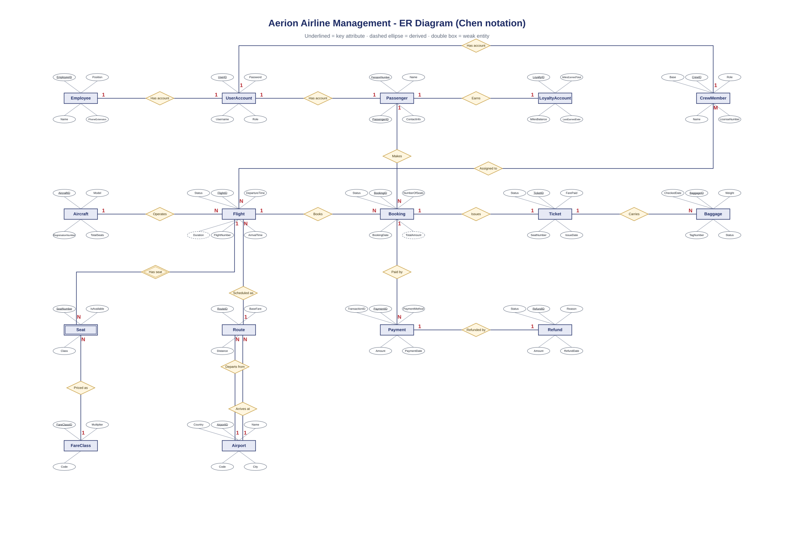

# Aerion - Airline Management System (C#)

CSAI 202 database project. ASP.NET Core Razor Pages, C# and SQL Server through ADO.NET, with Bootstrap for the pages. Built only with what the labs covered: Razor syntax, handler methods (`OnGet`, `OnPost`, named handlers), `ViewData`, forms and tag helpers.

## Users
- **Passenger**: sign up, log in, change password, search flights, pick a seat on the cabin map, pay, see and cancel bookings, change seat, see miles, track bags and report a lost bag.
- **Staff**: find a booking by number or name, book at the counter for a passenger, check in, move a seat, register bags and mark them delayed or lost, set flight status, passenger list.
- **Admin**: create staff and admin accounts, add or edit flights, routes, airports, aircraft, assign crew, set miles per class, booking history, reports (revenue by route, how full each flight is).

Loyalty: every 40 miles gives 10% off (up to 30%). Business seats earn double miles and cost 2.8x the economy fare.

## ER diagram

The editable version is `docs/er-diagram.drawio` (open in draw.io).

## Run it
1. Install the .NET 8 SDK and SQL Server (LocalDB comes with Visual Studio).
2. Run `Database/schema.sql` in SSMS. It creates the `AerionAirline` database and all tables.
3. Check the connection string in `Aerion/appsettings.json`.
4. From the `Aerion` folder run `dotnet run`. On the first run the app fills the empty database with demo airports, routes, aircraft, crew, flights and seats.

Demo accounts (created on the first run): `admin1` gets the password from `Seed:AdminPassword` in appsettings or, if it is empty, a random one printed in the console on the first run. In Development only, demo accounts `staff1 / Staff@123` and `passenger1 / Pass@123` (120 miles) are also created.

## Notes
- All database access goes through the `Db` class (parameterised ADO.NET commands).
- Passwords are stored as PBKDF2 hashes, never as text.
- A booking runs in one SQL transaction. The seat is taken with `UPDATE ... WHERE IsAvailable = 1`, so two people cannot get the same seat.
- Pages check the role in `AppPage`; a passenger cannot open staff or admin pages.
